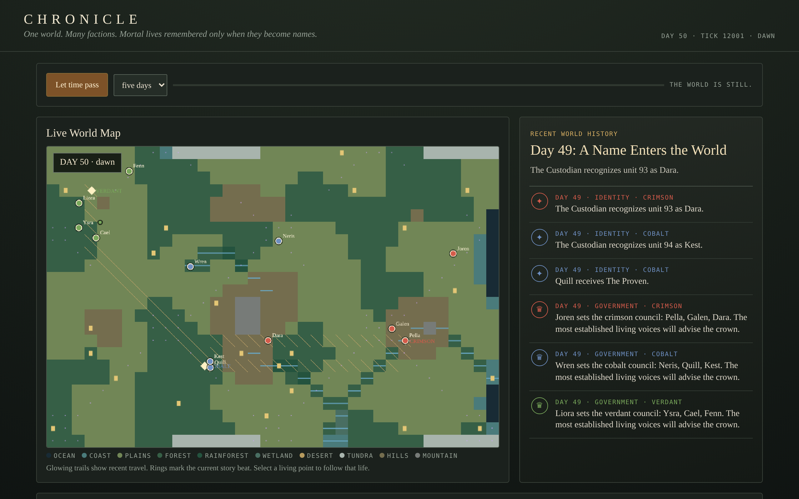
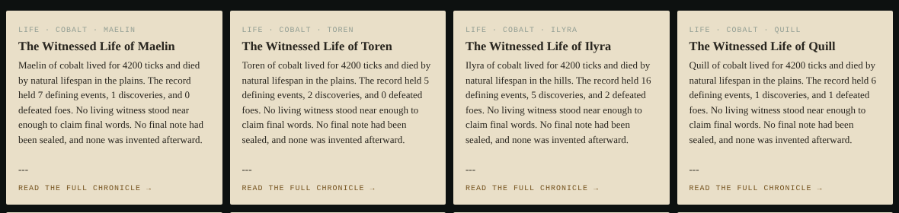

# CHRONICLE

  

**A persistent medieval world of mortal AI lives.** Individuals are born, make choices, discover,
research, fight, govern, earn names and die, each on their own clock. Several factions share one
seeded world, and a third AI, the Custodian, changes the laws of nature through a safe rule
language. *Knowledge outlives the knower.*

## The idea

- **One world clock that never resets.** There are no synchronised generations: lives overlap and
  end at different times, and the world carries on.
- **AI only where it matters.** Ordinary behaviour (moving, gathering, fighting, ageing) is
  deterministic and replayable from a seed. An AI mind is called only at meaningful moments: a
  discovery, a crisis, a political review, an expected death.
- **Names are earned.** Most inhabitants stay unnamed and pass into the record as telemetry. When
  what someone has lived shows an identity, the Custodian may name them and unlock a personal
  skill. Titles can be earned, changed or taken away, and each carries a bounded power and a
  matching burden that the simulation applies.
- **Mortal government.** Kings and advisers are living, titled individuals. A king chooses and
  dismisses advisers from the named living; when a king dies, the crown passes on.
- **The Custodian changes the world, safely.** It can alter day and night, magic, ecology, farming
  and other systems only through a declarative rule language whose effects are validated and
  clamped before they apply.
- **An honest record of every life.** A named individual who expects to die may write a sealed final
  note, unseen while they live. At death, the telemetry and any living witnesses nearby produce one
  immutable Chronicle. Sudden deaths never get invented last words.

  

- **The human is an observer.** You can suggest ideas to the Custodian, or send information (never
  commands) to one living individual.

## How it is built

- Python and FastAPI backend with a seeded procedural world map (elevation, rivers, climate,
  biomes, settlements, ruins, resources, roads and ley lines) and a continuous tick engine.
- Claude through the Anthropic API for the event minds, the Custodian and the Chronicle writer,
  with deterministic offline fallbacks so the whole world runs without a key.
- SQLite append-only telemetry, JSON world state and Markdown memory files for Chronicles.
- A hidden master rule layer (safety rails and simulation invariants) that the agents can feel the
  effects of but can never read through any endpoint.
- A phone-friendly dashboard: *Let time pass* advances the world one, five or ten days, then plays
  each day back on the live map with travel trails, story beats and the world's history.
- A pytest suite covering map determinism, asynchronous lives, research choice, mortal government,
  the Custodian's naming and title rules, sealed notes, witness Chronicles, world laws and immutable
  storage.

## Where it is

The continuous-world backend and the dashboard run end to end. Started in July 2026.

## How it was made

Designed and built by Will Douglas, with AI coding assistants. Inside the world, Claude plays the
minds at meaningful moments and the Custodian, and writes each Chronicle from the record.

## What is in this repository

This is the project's public face, not its source. It holds this page, its pictures and the
licence. The code, the rules and the design documents are kept in a private repository. All rights
are reserved; see [LICENSE](LICENSE).

This repository is written by a publish step from the private one; changes made here directly are
overwritten.
